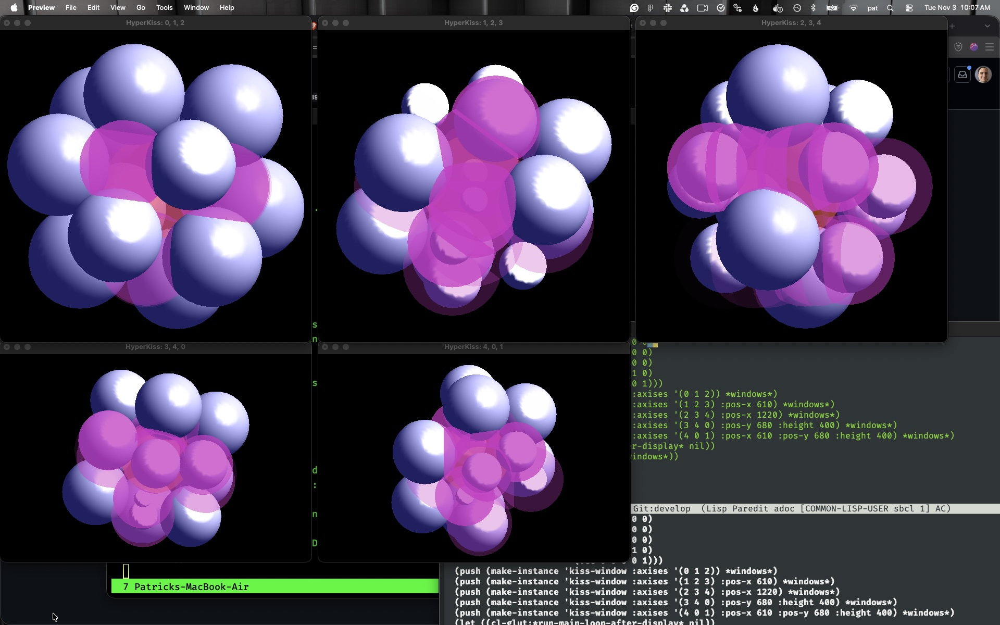

HYPERKISS
=========

The [Kissing Number][wikipedia] in a given dimension is the number of
balls you can get to touch a given ball (where all of the balls are
the same size).

In one dimension (where balls are line-segments), the answer is
two. You can make one touch it on the left and one touch it on the
right. And, there's no room left over.

In two dimensions (where balls are discs), the answer is six. You can
fit six around a center one with no wiggle room.

In three dimensions, the answer is twelve. There is a lot of wiggle
room, but it has been proven that there isn't room for thirteen.

In four dimensions, the answer is twenty four. There is a lot of
wiggle room, but it has been proven that there isn't room for twenty
five.

In eight and twenty-four dimensions, the answers are 240 and 196,560
respectively.  Those configurations have no wiggle room and so are the
best possible arrangement.

In all of the other dimensions, the answer is unknown. For example,
in five dimensions, it is known that forty will fit and that forty five
will **not** fit. But, no one knows if you can fit forty one, forty
two, forty three, or even forty four.

This program attempts to graphically display arrangements in any number
of dimensions utilizing multiple three-dimensional viewports.

Currently, it is a bunch of utilities and then some scratch work
in `hyperkiss.lisp` where most of the real action happens at the moment.

Here is a screenshot of a 5-dimensional lattice packing that demonstrates
the current best known lower-bound on the kissing number in five dimesions.

[wikipedia]: https://en.wikipedia.org/wiki/Kissing_number
